<p align="center">
  
</p>

A desktop for CachyOS and Hyprland that looks like a terminal: square frames, one
monospace font and the same colors in every app. It started as my dotfiles and grew
into its own shell.

<p align="center">
  
</p>

## What's in it

- A Quickshell shell: bar, control center with GoXLR faders and an app mixer, launcher,
  lockscreen, notifications, OSD, screenshots and recordings, a wallpaper app and a game
  mode that switches itself on
- Tiling with workspaces, or an infinite canvas where windows float on an endless plane
- A launcher that does more than apps: Spotify, Discord DMs, timers and alarms,
  emoji, files, ssh, clipboard, web search and Claude
- Bridges to Discord (calls, voice joins, messages), Steam (its popups land in the shell), the GoXLR and Spotify
- Six themes for Ghostty, fish, Starship, Spotify, Vesktop, Steam, Zed, Dolphin, Zen, GTK apps,
  GRUB, the boot splash, the text consoles and the GoXLR's lights
- `facet`, one command to install, update and switch themes

## Install

```bash
curl -fsSL https://facet-shell.github.io/install.sh | bash
```

It asks for the full desktop or just the shell, then the apps one by one, the layout and the
theme; a connected GoXLR gets its utility on its own. Only what you pick is downloaded: every
part is its own repo here, and this one holds the docs.

| Repo | |
|---|---|
| [cli](https://github.com/facet-shell/cli) | the `facet` command and the six themes |
| [core](https://github.com/facet-shell/core) | what every style shares: services and bridges, settings, the infinite canvas, Hyprland config, wallpapers |
| [style-tui](https://github.com/facet-shell/style-tui) | the tui style: bar, launcher, lockscreen, control center, editors, login and boot screens |
| [terminal](https://github.com/facet-shell/terminal) | Ghostty, fish, Starship, fastfetch |
| [spotify](https://github.com/facet-shell/spotify) · [discord](https://github.com/facet-shell/discord) · [steam](https://github.com/facet-shell/steam) | the apps themed, bridged into the shell |
| [keyboard](https://github.com/facet-shell/keyboard) | lighting and keys for the AULA F75 |
| [zed](https://github.com/facet-shell/zed) · [zen](https://github.com/facet-shell/zen) · [dolphin](https://github.com/facet-shell/dolphin) | themes for the editor, the browser and the file manager |

<p align="center">
  
</p>

## Using it

| Key | |
|---|---|
| Super+Space | launcher |
| Super+V | clipboard history |
| Super+C | control center |
| Super+, | settings: theme, layout, lock, sound, modules, system |
| Super+W | wallpapers |
| Super+K | keyboard: lighting, Fn keys, key colors (AULA F75, not tested on the board yet) |
| Super+G | media: screenshots and recordings, edit, delete many at once |
| Super+L | lock |
| Super+Tab | the desktop or the games workspace |
| Alt+Tab, Super+Alt+B | next window brought up, active window to the back |
| Super+Alt+S, Super+S | window into the scratchpad and back, show the scratchpad |
| Print, Shift+Print | screenshot: region or window, whole screen |
| Super+Shift+R | screen recording, again to stop |
| Super+wheel | zoom out to every window (canvas layout) |
| Super+E, Super+B, Super+Shift+E | Dolphin, Zen, Zed |
| Super+Shift+Escape | restart the shell (a watchdog does it by itself when it hangs) |
| hold Super | all hotkeys on a keyboard map |

```bash
facet theme set sakura   # periwinkle, sakura, matcha, ember, lagoon, mono
facet style tui          # the look: tui today, bloom soon; theme is its colors
facet update             # pull and apply everything again
facet status             # what is linked and what is missing
facet login              # the lockscreen look as the login screen
```

The details are in [docs](docs/): [the shell](docs/shell.md), [Spotify](docs/spotify.md), [Steam](docs/steam.md),
[the keyboard](docs/keyboard.md), [themes](docs/themes.md) and [the facet command](docs/facet.md). Ideas and bugs go on
[the board](https://github.com/orgs/facet-shell/projects/1).

> Work in progress. It runs on my CachyOS machine, but it still has bugs and is not ready for
> anyone else's desktop yet. What to try and how: [TESTING.md](TESTING.md).

Thanks to [system24](https://github.com/refact0r/system24) (the base of the Vesktop
theme), [caelestia](https://github.com/caelestia-dots), [end-4's dots-hyprland](https://github.com/end-4/dots-hyprland)
and [Quickshell](https://quickshell.org).
